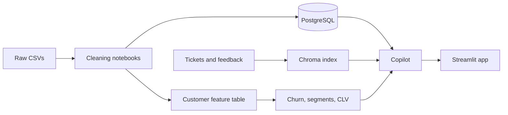

# Netflix Customer Intelligence AI Copilot

A customer-intelligence app for a synthetic Netflix-style subscription business. It loads nine cleaned tables into PostgreSQL, scores customers with saved churn, segmentation, and lifetime-value models, and answers questions through a copilot that can query the database, search support text, explain a churn score, recommend a retention action, write a business report, and investigate a change in churn.

The dataset is synthetic. It was built to demonstrate the work, and the metrics are not Netflix's.


## Architecture



A longer write-up, with the same diagram and a screenshot of each page, is in [docs/final_report.md](docs/final_report.md).

## Features

Six copilot capabilities:

- text-to-SQL with a guard that allows one read-only `SELECT`
- support search over tickets and feedback, with a summary that states how many records it used
- a churn explanation written only from a calculated fact sheet
- a retention action chosen by rules, then worded by the model
- weekly, monthly, and quarterly reports, with calculated facts separated from the model's interpretation
- a region-and-month churn investigation that stops before the model if the region or month is invalid

Three models, saved in `models/`:

- balanced logistic regression for churn, decision threshold 0.46, held-out recall 0.71, ROC-AUC 0.70
- K-means segmentation, K = 4: Long-tenure payment friction, Dormant at-risk, Newer active signups, High-value loyal
- random forest for historical lifetime value, held-out MAE about $11

Seven app pages: Executive Dashboard, Customer Analytics, Churn Prediction, Customer Segmentation, AI Analytics Copilot, Support Intelligence, and Automated Reports.

## Setup

These steps assume a Unix shell. On this project the database container `netflix-db` publishes host port **5433**. A new database can use port 5432 instead. Put the port you actually use in `.env`.

1. Create a virtual environment and install dependencies.

```bash
python3 -m venv venv
source venv/bin/activate
pip install -r requirements.txt
```

2. Copy `.env.example` to `.env` and replace every placeholder. The names to set are listed in `.env.example`: the database location, the read-only role the copilot uses, the model name, and the model key. Do not commit `.env`. Do not put keys or database locations in code.

3. Start PostgreSQL and create an empty database named `netflix_intelligence`. Then create the tables:

```bash
psql -U postgres -d netflix_intelligence -f database/schema.sql
```

The copilot role must be allowed to read and must not be allowed to change data. Its secret stays in `.env` only.

4. Load the cleaned tables. The loader reads `data/processed/*_clean.csv`, which the cleaning notebook writes and which is not in git. If those files are missing, run `notebooks/01_data_cleaning.ipynb` first. The raw CSVs are already in `data/raw/`.

```bash
python database/load_data.py
```

5. Build the feature table and confirm the model files exist. `notebooks/03_feature_engineering.ipynb` writes `data/processed/customer_features.csv`. Notebooks 04, 05, 06, and 07 train and save the models. The model files and `models/model_metadata.json` are already in the repository, so you can skip training if you only want to run the app. The feature CSV is still required, because the app scores customers from it.

6. Build the support search index. This reads the cleaned ticket and feedback files and writes `data/vector_store/`, which is gitignored.

```bash
python -c "from src.llm.support_rag import build_support_index; print(build_support_index())"
```

7. Start the app.

```bash
streamlit run app/dashboard.py
```

Open the local URL Streamlit prints. The home page heading is Executive Dashboard. The sidebar name of that page stays `dashboard`.

## Project structure

```text
app/                  Streamlit dashboard, pages, and shared helpers
database/             schema, loader, and the 37 SQL questions
data/raw/             original CSVs
data/processed/       cleaned tables and the feature table (gitignored)
data/vector_store/    Chroma index (gitignored)
docs/                 test log, final report, screenshots
models/               saved churn, segmentation, CLV, and optional satisfaction models
notebooks/            numbered notebooks from cleaning through the copilot demo
reports/              saved business reports and the model evaluation note
src/                  features, models, and copilot code
tests/                pytest suite
```

## Tests

From the project root, with the virtual environment active:

```bash
pytest
```

That run does not call the language model. The six smoke tests stay skipped unless you set `RUN_COPILOT_SMOKE=1`, which spends model calls. The manual checklist is [docs/test_log.md](docs/test_log.md).

## Key results

- 8,000 customers after removing 48 exact duplicate rows. 6,009 have an Active subscription. The churn rate is 24.89%. Successful-payment revenue is $1,430,511.33.
- Churn model, held-out 1,600 customers, threshold 0.46: precision 0.34, recall 0.71, F1 0.46, ROC-AUC 0.70.
- Segments: Long-tenure payment friction (2,464), Dormant at-risk (195), Newer active signups (2,351), High-value loyal (2,990).
- 37 SQL questions in `database/sql_business_questions.sql`.

More detail is in [reports/model_evaluation.md](reports/model_evaluation.md) and [docs/final_report.md](docs/final_report.md).

## Limitations

- The data is synthetic.
- Churn labels are noisy, and the probabilities are not calibrated to the 25% base rate. Use the 0.46 threshold, not a literal probability.
- Lifetime value is historical spend, not future revenue.
- Support search often returns the same billing sentence for different questions. The retrieved rows are shown on purpose.
- `notebooks/02_exploratory_analysis.ipynb` has the exploratory charts. Run it from the project root after the cleaned files exist in `data/processed/`.
- Reports cover the latest complete week, month, or quarter in the data. They do not take a custom date.
- `notebooks/18_copilot_demo.ipynb` was not re-run as part of the app test. Some later cells in an earlier run stopped when the model client raised an error.
