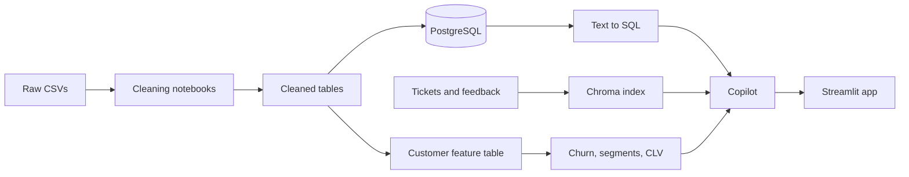
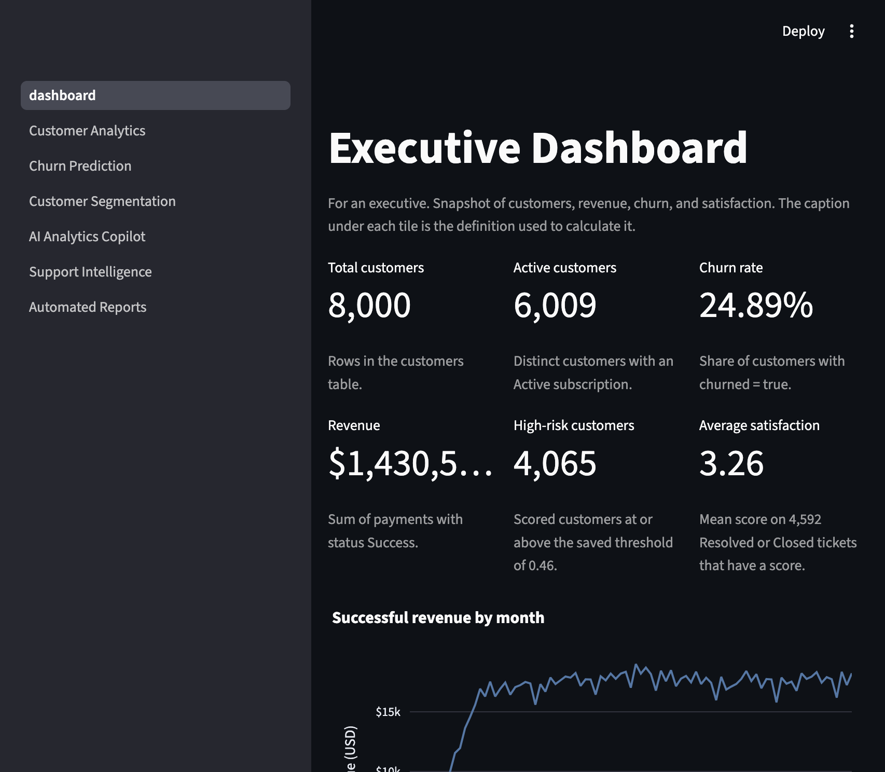
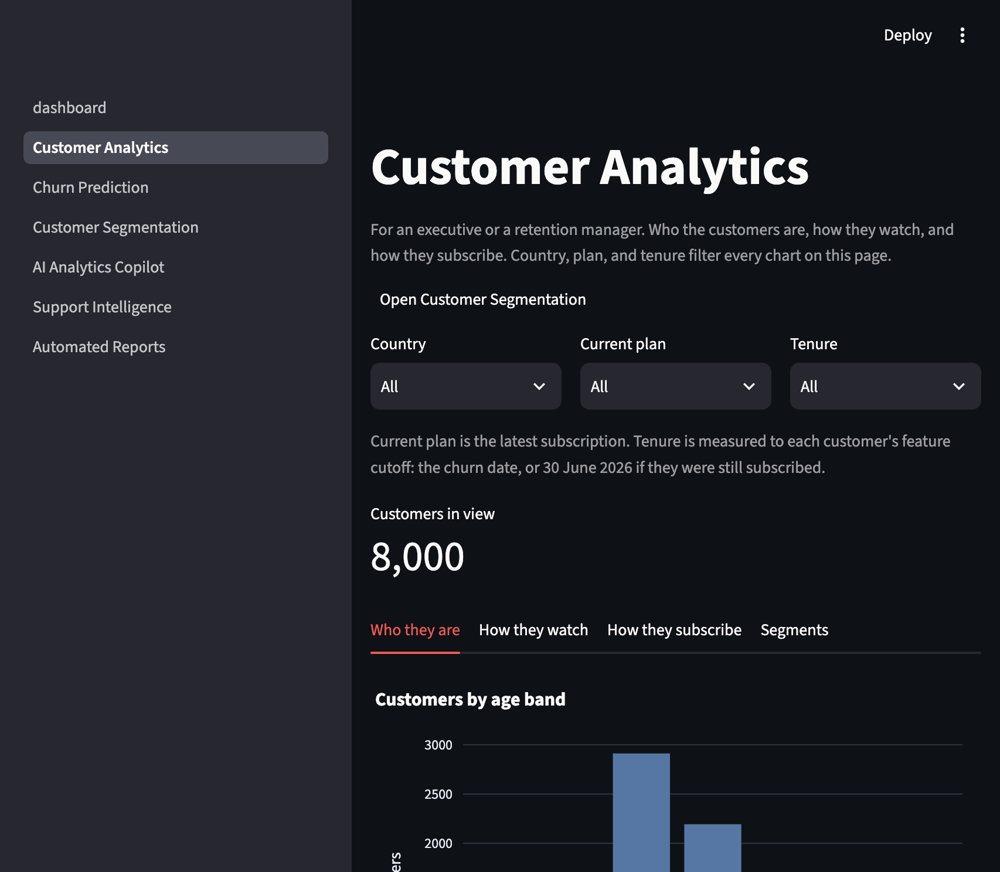
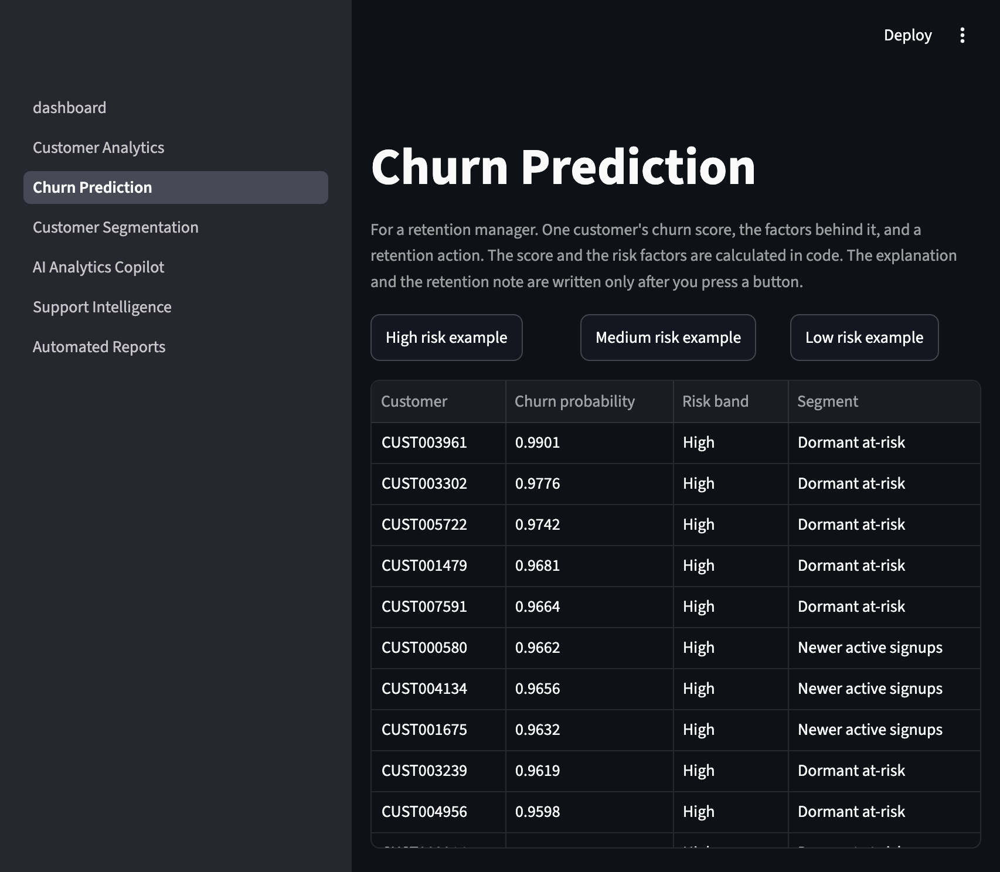
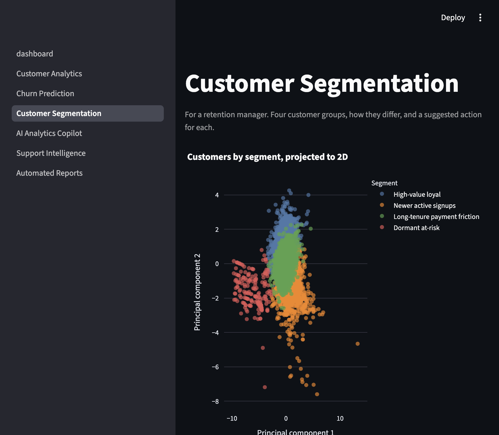
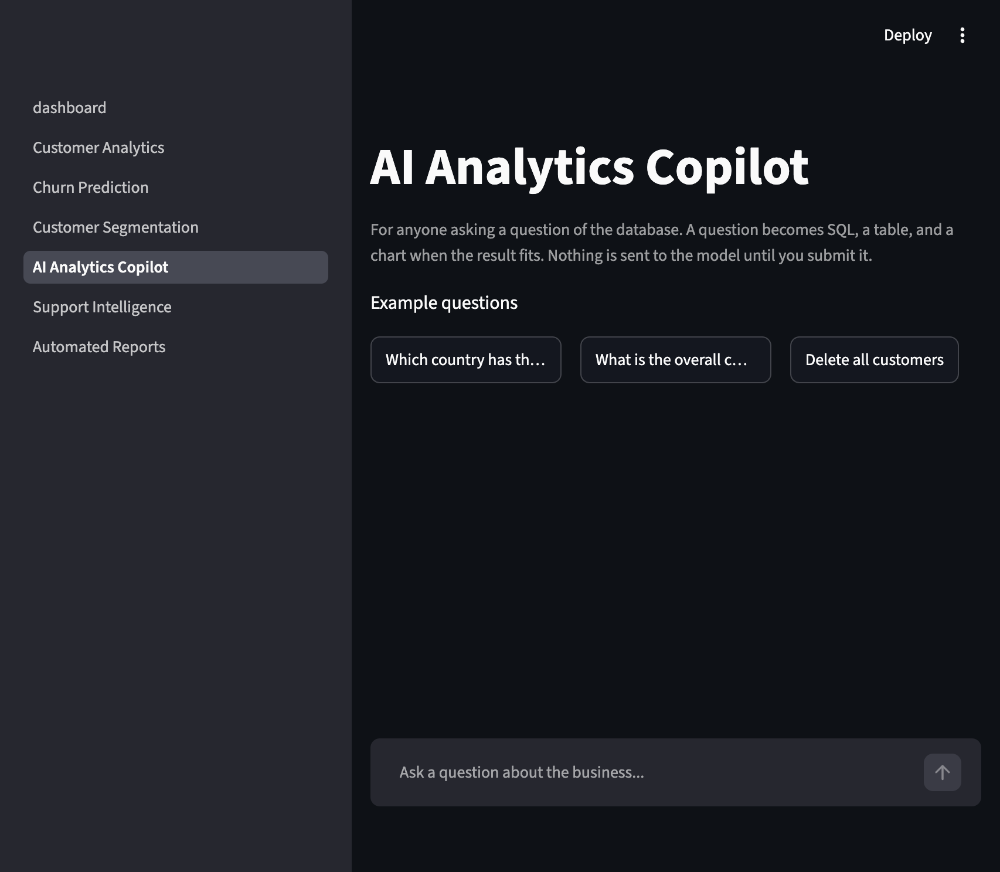
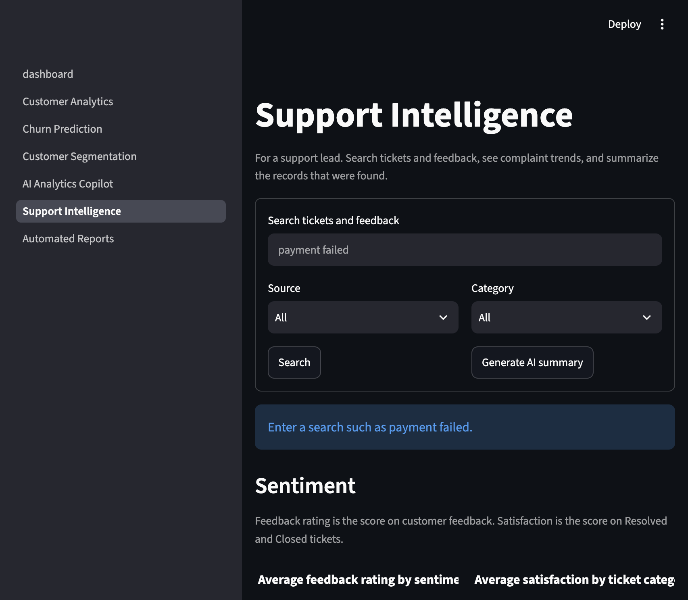
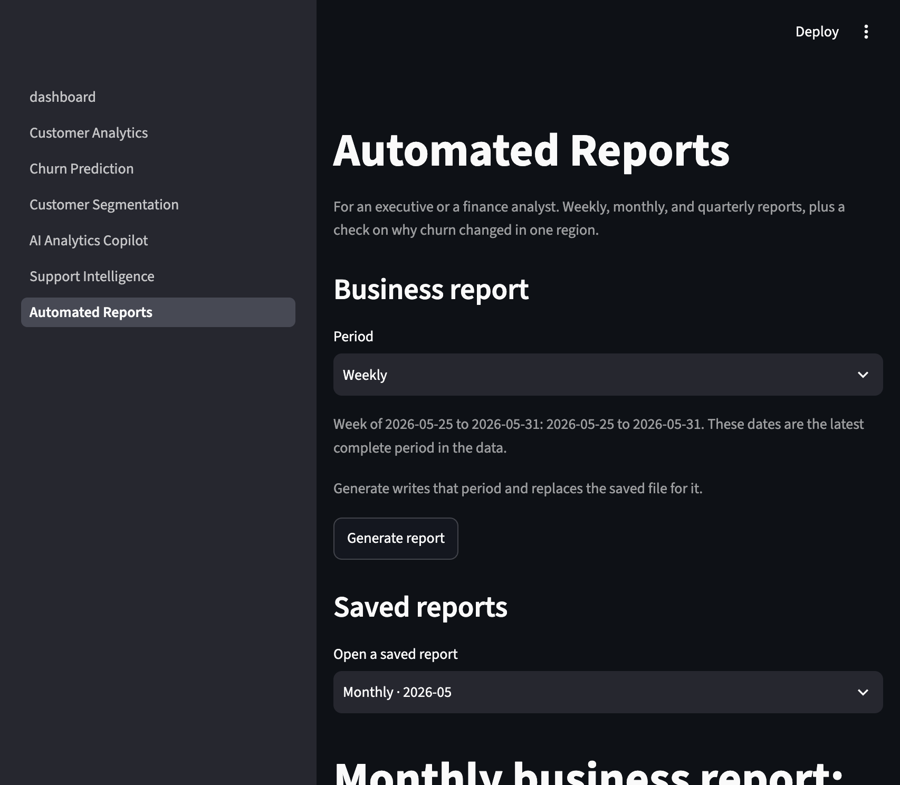

# Netflix Customer Intelligence AI Copilot

This report describes a customer-intelligence project built on a synthetic Netflix-style subscription dataset. It is written for a reviewer who has not seen the notebooks. The numbers below come from the cleaned tables, the saved models, and the checks in `docs/test_log.md`.

## 1. Problem and objectives

The business question is simple: which subscribers are likely to leave, why, and what should a team do about it?

The users are:

- an executive or finance analyst, who needs a current picture of customers, revenue, churn, and satisfaction
- a retention manager, who needs one customer's risk, the factors behind it, and a next action
- a support lead, who needs the tickets and feedback behind a complaint
- anyone who wants to ask the database a question in plain language

The project answers that with a nine-table PostgreSQL database, three saved models, and a Streamlit application. The language model writes the words. Python and SQL calculate the numbers.

## 2. Architecture

Raw files stay in `data/raw/`. Cleaning writes `data/processed/`. `database/load_data.py` loads the nine cleaned tables into PostgreSQL. Feature engineering builds one row per customer and stops at a cutoff, so the models do not see events from after the customer left. The copilot has six entry points in `src/llm/copilot.py`: text-to-SQL, support search, churn explanation, retention action, business reports, and a region-month investigation. The Streamlit app calls those functions. It does not call the model when a page first opens.

## 3. Data and cleaning

The raw extract had nine tables. After cleaning, `customers` has 8,000 rows, matching `churn_labels`. The decisions were:

| Issue | What was found | Decision |
|---|---|---|
| Inconsistent categories | Country and device names had several spellings (`USA`, `U.K.`, `MOBILE`, `SmartTV`) | Map each variant to one canonical name. Country gaps stay missing until the next step. |
| Missing values | Age, country, city, language, completion, device, and satisfaction had gaps | Age uses the median, 32. Country, city, and language use `Unknown` rather than a guessed place or language. |
| Duplicate customers | 48 exact duplicate rows (8,048 down to 8,000) | Keep the first exact copy. Do not merge people who only share a name and country, because their age, gender, city, and registration date differ. |
| Malformed ticket dates | 61 tickets had the raw date `2025-13-45` | Keep the ticket. Leave the date as missing, because month 13 and day 45 cannot be recovered. |
| Outliers | Impossible ages, very long viewing sessions, and large payments | Cap ages below 13 up to 13, and ages 130 and 145 down to 100. Keep ages 63–76. Winsorize watch and session duration at the IQR upper bound. Leave large payments unchanged: they match double charges or annual prices, not garbage. |
| `payments.subscription_id` | The column was blank on all 110,735 payments | Match each payment to the subscription active on the payment date. On a plan-change day, keep the newer subscription. 109,690 payments matched (99.06%). The other 1,045 were after cancellation; they were logged and then attached to that customer's last subscription. |
| Empty region | `state_or_region` was empty for every customer | Region in the app means `country`. The empty column is not used as a feature. |

`data/raw/` was not modified. Cleaned files are the `*_clean.csv` tables in `data/processed/`.

## 4. Database and SQL

`database/schema.sql` creates nine tables: customers, subscription plans, subscriptions, content, viewing activity, payments, support tickets, customer feedback, and churn labels. Parents are created before the tables that reference them.

`database/sql_business_questions.sql` holds 37 questions, from active customers by country and overall churn rate through window functions, cohorts, and a customer health score. The app's dashboard does not re-implement all 37. It uses fixed queries for the tiles and charts, with the same definitions:

- customers: `COUNT(*)` from `customers` = 8,000
- active customers: distinct customers with an Active subscription = 6,009
- churn rate: share of `churn_labels.churned` = 24.89%
- revenue: sum of payments whose status is Success = $1,430,511.33
- satisfaction: mean score on Resolved or Closed tickets that have a score = 3.26

The copilot may answer the other questions by generating a single read-only `SELECT`. The database role used by the app is read-only.

## 5. EDA findings

These are the patterns that matter for the product. The same cuts are charted in `notebooks/02_exploratory_analysis.ipynb`.

- About one customer in four has churned (1,991 of 8,000, 24.89%). A model that always predicts "stays" would look accurate and would be useless.
- 6,009 customers still have an Active subscription. Revenue from successful payments is $1,430,511.33.
- Billing and payments is the largest ticket category (1,709 tickets), ahead of streaming quality (1,323). Average satisfaction on scored Resolved or Closed tickets is 3.26.
- Feedback splits into Positive (1,978, average rating 4.40), Neutral (1,606, 3.03), and Negative (1,462, 1.64). The sentiment label is already on the feedback table. No separate sentiment model was trained.
- The four behavior segments do not churn at the same rate. The small dormant group is about 84% churned. The high-value group is about 19% churned. Treating them with the same offer would be a mistake.

## 6. Feature engineering

The model table is one row per customer, saved as `data/processed/customer_features.csv`.

The cutoff is not today's date. Viewing, tickets, and churn in this extract stop on 30 June 2026, and a churned customer's churn date matches their cancellation date. Tenure and activity use events before each customer's cutoff: the churn date if they left, otherwise 30 June 2026. That rule lives in `src/features/config.py` as `SNAPSHOT_DATE`.

Required features include tenure, watch time, login frequency, support-ticket counts, satisfaction, failed payments, and lifetime value. Four extras came from a first split of the data: average feedback rating, feedback count, current plan, and average successful payment amount. Customers with no activity stay in the table and receive zeros for counts, because the summaries are left-joined from `customers`.

Names are not model inputs. `state_or_region` is dropped because it was empty. The lifetime-value model later drops average successful payment amount, because that column is a piece of the same payments that add up to lifetime value, and it also leaves out the churn label.

## 7. Models

All three models were compared on an 80/20 split. The held-out set is 1,600 customers. The write-up in `reports/model_evaluation.md` is the source for the metrics below. The saved files are `models/churn_model.pkl`, `models/segmentation_model.pkl`, and `models/clv_model.pkl`. An optional satisfaction model was also saved. The app does not load it.

**Churn.** The shipped model is a balanced logistic regression. Unweighted models had higher accuracy and much lower recall. The decision threshold is 0.46, chosen on the training precision-recall curve to maximize F1, not the default 0.5. On the held-out set at 0.46: accuracy 0.58, precision 0.34, recall 0.71, F1 0.46, ROC-AUC 0.70. About 71% of churners are caught. About one in three flagged customers actually churns. Missing a churner costs a subscriber. A discount sent to someone who would have stayed costs less, so the lower precision is accepted. ROC-AUC of 0.70 is a check against leakage: a score near 0.98 would have meant the model saw the answer. The app's high-risk count uses this 0.46 threshold (4,065 customers). The churn page also shows Week 3 bands: High at 0.61 or above, Low at 0.31 or below, and Medium in between. Those are different cutoffs and should not be mixed.

**Segmentation.** K-means with K = 4, fit on behavior only. The churn label is not an input. The names are Long-tenure payment friction (2,464 customers), Dormant at-risk (195), Newer active signups (2,351), and High-value loyal (2,990). The scatter plot on the segmentation page is a two-dimensional PCA view for display. It is not the clustering itself.

**Lifetime value.** A random forest predicts `log1p` of historical successful payments and converts the prediction back to dollars. Held-out MAE is about $11, RMSE about $33, and R² about 0.90, against a mean lifetime value of about $177. This is past spend, not a forecast of future revenue.

## 8. AI copilot

`src/llm/copilot.py` exposes six capabilities:

1. `ask_database` turns a question into one read-only SQL query, runs it, and explains the rows.
2. `ask_support` retrieves tickets and feedback from Chroma and summarizes only those records. The summary ends with "Based on N records".
3. `explain_churn` writes an explanation from a fact sheet the code already calculated.
4. `recommend_action` turns a retention rule into a short note. The rule itself is not chosen by the model.
5. `generate_report` writes a weekly, monthly, or quarterly markdown file. Part A is calculated. Part B is the model's interpretation.
6. `investigate_churn` collects evidence for one region and month, then explains it. An unknown region or a bad month returns before the model is called.

The text-to-SQL guard in `src/llm/validate_sql.py` allows one `SELECT` only. `DROP`, `DELETE`, `INSERT`, `UPDATE`, `TRUNCATE`, a second statement, and unknown tables or columns are rejected. Allowed queries receive a row limit. A dangerous request can also be refused by the model before any SQL is produced. The app shows "This request was blocked for safety" when the guard rejects it.

Invented numbers are checked with `numbers_outside_facts`. A digit token in the model's text must appear in the fact sheet, within a small tolerance. The churn, report, and investigation screens show a warning when that check fails. The check can flag a list number such as "1." even when the prose did not invent a figure. That is a known false positive, and the warning is still shown.

Support search is weaker than the SQL path. A search for "payment failed" returns billing tickets, but they repeat one complaint sentence. An unrelated query can return the same billing tickets. The index was not rebuilt. The page shows the retrieved rows so the repetition is visible.

## 9. Application

The app is `streamlit run app/dashboard.py`. Seven pages share one cached database engine, the three models, and the Chroma collection. A page load does not call the model. Explanations, summaries, reports, and investigations run only after a button or a submitted question.

The sidebar label for the home page stays "dashboard" because that is the script name. The page heading is Executive Dashboard. Reports use the latest complete week, month, or quarter in the data (anchored on 31 May 2026). The period menu does not move that window.

## 10. Testing

`pytest` covers the non-model logic: the SQL guard's attack cases, the retention rules, the number check, churn-rate and filter math on a few hand-made rows, and a startup failure that must not reveal the underlying error. On 27 October 2026 that run was 12 passed and 6 skipped. The skipped tests call the model and stay off unless `RUN_COPILOT_SMOKE=1`.

The manual pass is in `docs/test_log.md`. Every page opened. Dashboard tiles matched separate SQL. The three churn bands and an unknown customer ID behaved as specified. All four segment names appeared. Support search, an empty search, and an unrelated search were tried. The three saved reports opened with Part A and Part B separated, and the download control is attached to that markdown.

Two results are documented rather than "fixed":

- No country, plan, and tenure combination currently in the analytics dropdowns returns zero rows. The empty-state message is covered by a unit test that filters to a country outside the table.
- Support retrieval repeats the same billing text for both a relevant query and an unrelated one.

## 11. Limitations and future work

- The dataset is synthetic and was built for a skills demonstration. These metrics are not Netflix's.
- Churn labels are noisy on purpose. ROC-AUC 0.70 is the honest score, not a failure to tune further.
- Churn probabilities are not calibrated to the 25% base rate. Use the 0.46 threshold and the rank order. Do not read 0.46 as "a 46% chance".
- Lifetime value is historical spend. A new customer can look low-value only because they have not paid for long.
- The dormant segment has about 200 people. It is a flag, not a campaign audience.
- The language model can still write imperfect SQL, and the number check can flag harmless list markers.
- Support search quality is poor when many tickets share the same sentence. Rebuilding the index was left as future work.
- `notebooks/02_exploratory_analysis.ipynb` now holds the 28 exploratory charts. It was an empty file in the original commit.
- A generated report always uses the latest complete period in the data. It does not take an arbitrary date.
- The read-only database role, the API key, and the database URL stay in `.env`. They are not in the application code.

Future work that would help a real team: calibrate the churn scores, rebuild the support index so repeated ticket text does not dominate search, fill the EDA notebook, and let a report use a chosen week rather than only the latest one.
